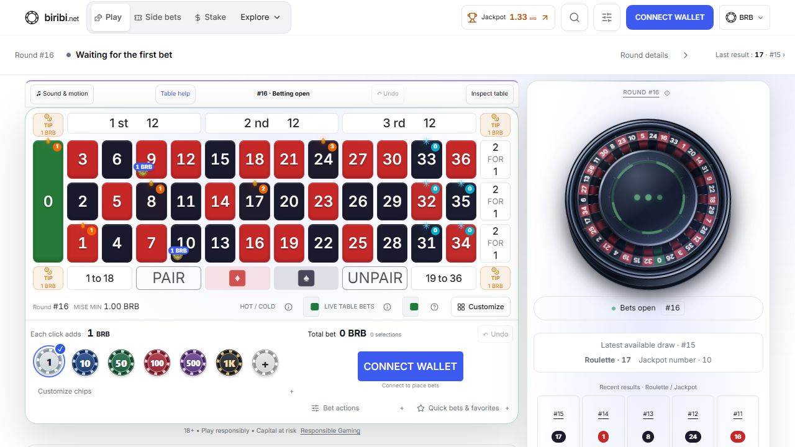

# Biribi Brand & Media Kit

The official media kit for Biribi, an onchain roulette protocol on Arbitrum One. Find logos, product screenshots, and ready-to-use copy for articles, ecosystem listings, and community projects.

🎨 **[Explore brand.biribi.net](https://brand.biribi.net/)** · 📦 [Download the media kit](https://brand.biribi.net/assets/biribi-media-kit.zip?v=3) · 🎡 [Explore Biribi](https://biribi.net/)

## Inside the kit

| | What you’ll find |
| --- | --- |
| 🎨 **[Brand assets](https://brand.biribi.net/#assets)** | Blue and white chip artwork, the Biribi wordmark, brand colors, and screenshots of the homepage, roulette table, and bankroll vaults. |
| ✍️ **[About Biribi](https://brand.biribi.net/#about)** | Short and extended descriptions you can copy for coverage and ecosystem listings. |
| 🔎 **[Smart contracts](https://brand.biribi.net/#contracts)** | Arbitrum One contract addresses with Arbiscan links and a downloadable JSON file. |
| 📚 **[Documentation](https://brand.biribi.net/#docs)** | Game rules, the whitepaper, and links to verify roulette draws and payouts onchain. |

[Repository maintenance notes](docs/maintainers.md)
